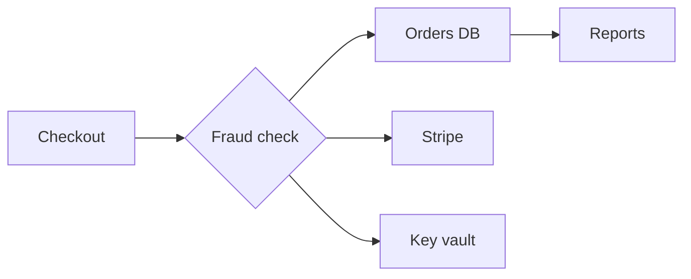

theme: editorial
lang: en
num: on
colors: accent=#BF4520
fonts: heading=Georgia body=Arial
sizes: title=38
style: radius=4
footer: Platform review

# Platform review {eyebrow="Engineering · Q3 2026"}
Architecture, throughput and cost, Q3
@defaults

# How a request travels
> One focal service; the rest keeps to the quiet roles
@arch
@noemph defaults
## Client
- [WEB] Web client: browser app {.external}
## Platform
- [API] API gateway: auth · limits {.focal}
- [DB] Postgres: orders · users {.store}
- [OBJ] Nightly backup: object copy {.optional}
> Web client > API gateway, API gateway > Postgres, Postgres > Nightly backup

# Where the data goes

@noemph defaults

# Orders grew all year
@3:2
```column {title="Orders per quarter (k)" labels=on hl=Q3 note="Q3 doubled Q1"}
,Q1,Q2,Q3,Q4
Orders,120,150,240,260
Refunds,12,14,18,17
```
## Reading
- Growth came from **repeat buyers**
- Refunds stayed flat at 7%
@noemph defaults

# Cost per service
@1
```table {hl=Gateway}
Service,Owner,Monthly cost,Change
Gateway,Platform,"$4,200",+12%
Orders DB,Data,"$6,800",+3%
Search,Discovery,"$2,900",-8%
Reports,Analytics,"$1,100",+1%
```
@noemph defaults

# 注文基盤の再構築計画
> 読み取りと決済を分離し、繁忙期の遅延を半分にする
@4
@noemph defaults
## 現状
- 注文処理は単一のDBに集中
- 繁忙期の遅延 2.8秒
- 夜間バッチが翌朝に残る
## 課題
- 読み取りと書き込みが競合
- 障害時の復旧に4時間
- 監査ログが分散
## 施策 {.focal}
- 読み取りレプリカを追加
- 決済APIを分離
- ログを一元化
## 管理
- 鍵はVaultで集中管理
- 四半期ごとに権限を棚卸し
※ 出所：社内計測（2026年9月）。遅延は95パーセンタイル値。
